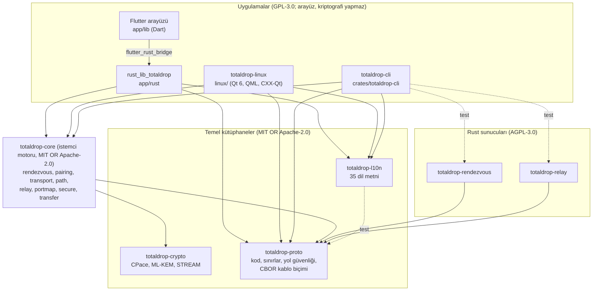
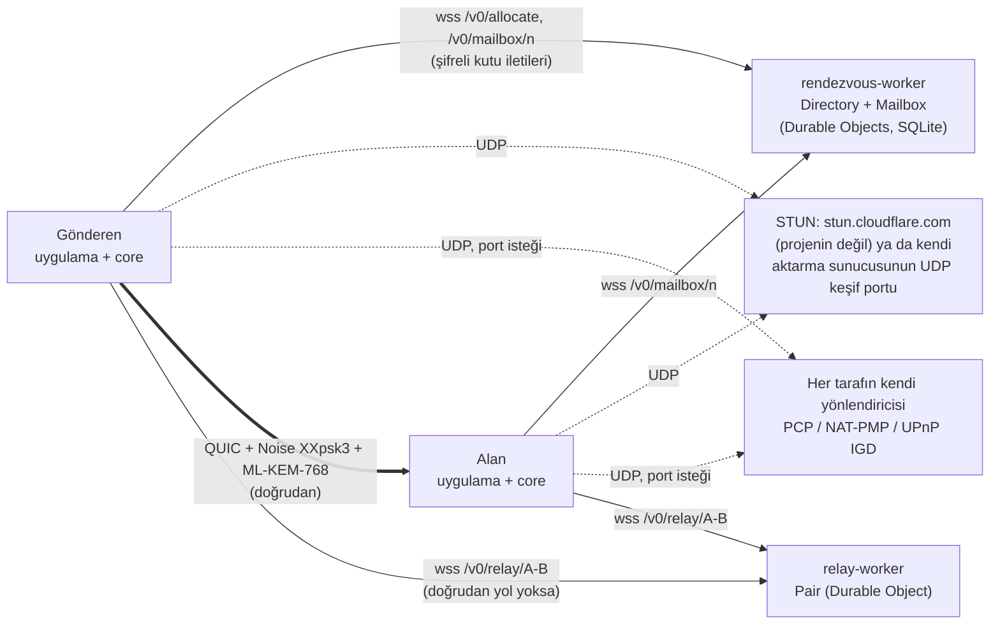
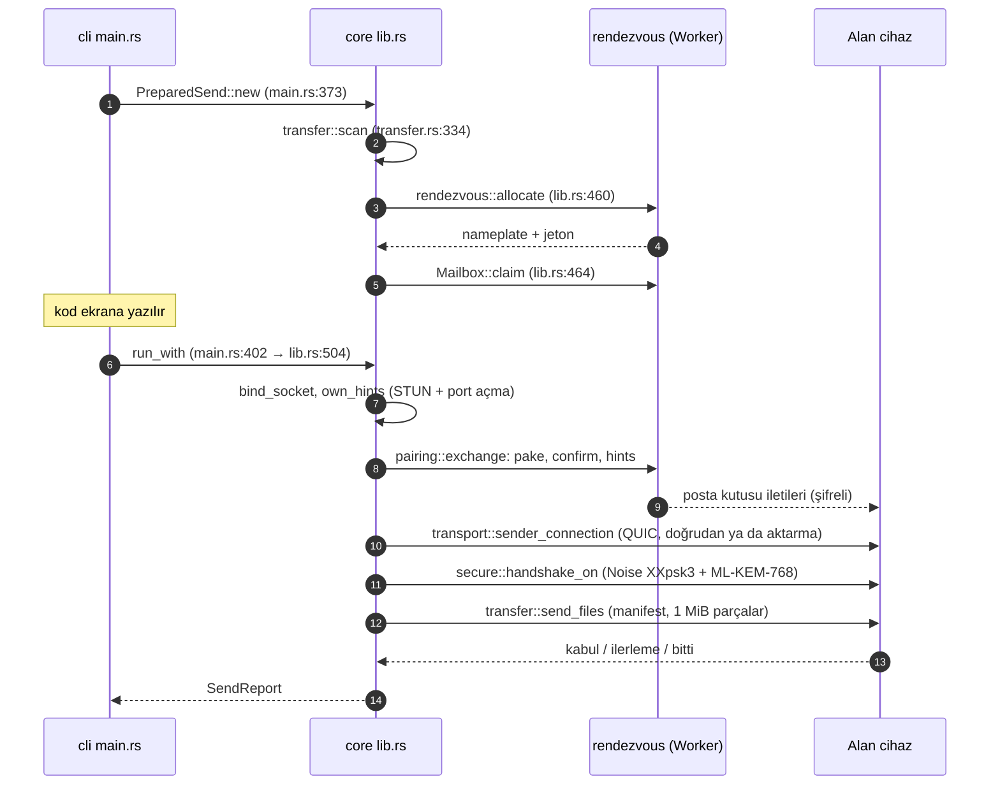

# Mimari haritası (kod düzeyi)

Bu belge [mimari.md](mimari.md)'nin kod düzeyindeki karşılığıdır.
`mimari.md` parçaları ve bir aktarımı kavram olarak anlatır; burası aynı
şeyi **hangi dosyada, hangi fonksiyonda** sorusuyla izler. Neden böyle
olduğu [kararlar/](kararlar/README.md), protokolün kendisi
[protocol-v0.1-notes.md](protocol-v0.1-notes.md), güven sınırları
[tehdit-modeli.md](tehdit-modeli.md) içindedir; burada tekrar edilmez.

- Durum: `main` `94de53e` (12 Kasım 2026). İlk sürüm `18ba4df`'e karşı
  yazıldı; 11 Kasım'da UPnP, denetim düzeltmeleri (#424–#427) ve aktarma
  Worker'ının birim testleri için güncellendi; 12 Kasım'da yalnız kayan
  satırlar izlendi. 5.2'deki kapsam sayıları
  ve 6. bölümün sayımları `18ba4df` dönemine aittir.
- Koda `yol:satır` ile bağlanır, yol hep depo kökünden yazılır.
  Kayan satırları CI yakalar: `tools/check-doc-refs.mjs` her başvurunun
  gösterdiği satırın metnini `docs/ARCHITECTURE.refs.json`'daki kayıtla
  karşılaştırır. Kod yalnızca yer değiştirdiyse
  `node tools/check-doc-refs.mjs --fix` numaraları düzeltir; satırın
  kendisi değiştiyse iddia koda karşı yeniden okunur, düzeltilir ve
  `--accept` ile kaydedilir.
- "**Emin değilim**" yazan yerler koddan doğrulanmamış, ölçülmemiş ya da
  eski bir ölçüme dayanır.
- Güvenlik bulguları [10 Kasım denetimi](#ek-10-kasım-denetimiyle-ilişki)
  issue'larında (#424–#428) izlenir; burada yalnızca mimariye dokunanlar
  anılır.

## İçindekiler

1. [Katmanlar ve bağımlılık yönü](#1-katmanlar-ve-bağımlılık-yönü)
2. [Akış takibi](#2-akış-takibi)
3. [Veri modeli ve durum](#3-veri-modeli-ve-durum)
4. [Yapılandırma](#4-yapılandırma)
5. [Test, derleme ve kapsam](#5-test-derleme-ve-kapsam)
6. [Tarihçe: sıcak noktalar](#6-tarihçe-sıcak-noktalar)
7. [Mimari gözlemler](#7-mimari-gözlemler)

## 1. Katmanlar ve bağımlılık yönü

Oklar "kullanır" demektir (Cargo bağımlılığı) ve hep aşağı doğrudur;
kesikli oklar yalnızca testlerde kullanılan bağımlılıktır. Ağ üzerinden
kimin kiminle konuştuğu bir sonraki diyagramdadır.

Çalışma anında (ağ):

Kendi sunucusunu kuranlar Worker'lar yerine aynı protokolü konuşan Rust
sunucularını (`server/totaldrop-rendezvous`, `server/totaldrop-relay`)
çalıştırır.

Kurallar ve kanıtları:

| Kural | Kanıt |
| --- | --- |
| `proto` ve `crypto` hiçbir iç crate'e bağlı değildir | `crates/totaldrop-proto/Cargo.toml`, `crates/totaldrop-crypto/Cargo.toml` (`[dependencies]` içinde `totaldrop-*` yok) |
| `l10n` hiçbir iç crate'e bağlı değildir; `proto`'yu yalnızca testinde kullanır (her dilin paylaşım metni kodu geri vermeli, #148) | `crates/totaldrop-l10n/Cargo.toml:21-23` |
| `core` yalnızca `crypto` ve `proto`'ya bağlıdır; arayüz metni bilmez | `crates/totaldrop-core/Cargo.toml:23-24` |
| Sunucular yalnızca `proto`'yu bağlar: kriptografi ve istemci motoru sunucuya hiç girmez | `server/totaldrop-rendezvous/Cargo.toml:20`, `server/totaldrop-relay/Cargo.toml:18` |
| Uygulamalar `core`, `proto`, `l10n` kullanır; hiçbir şey bir uygulamaya bağlı değildir | `crates/totaldrop-cli/Cargo.toml:20-22`, `linux/Cargo.toml:22-24`, `app/rust/Cargo.toml:19-21` |
| CLI, uçtan uca testler için iki Rust sunucusunu yalnızca test bağımlılığı olarak kullanır | `crates/totaldrop-cli/Cargo.toml:28-29` |
| `core` ile sunucular arasında kod bağı yoktur; yalnızca ağ protokolü ortaktır (`proto`) | tablo `tools/check-layers.mjs` `ALLOWED` |

Kod, bu tablo ve yukarıdaki katman diyagramı CI'da birbirine eşit
tutulur (`.github/workflows/ci.yml`, `Crate layers` işi):
`tools/check-layers.mjs` çalışma alanını Cargo'ya sordurur
(`cargo metadata --no-deps`; derleme yapmaz) ve izin tablosuyla
(`ALLOWED`, `ALLOWED_DEV`) karşılaştırır; tablonun izin vermediği bir iç
bağımlılık, tabloda olup kodda artık olmayan bir bağımlılık ya da tabloda
olmayan yeni bir crate işi kırmızı yapar. Aynı betik bu belgedeki
`%% layers` ile başlayan Mermaid bloğunu okur (düz ok normal, kesikli ok
test bağımlılığı) ve oklar tabloyla birebir aynı değilse yine kırmızı olur.
Manifestleri Cargo okuduğu için bağımlılığın yazılış biçimi
(`[dependencies.x]` tablosu, noktalı anahtar, hedefe özgü tablo, yeniden
adlandırma) sonucu değiştirmez. Denetimin kendisi
`tools/test-check-layers.mjs` ile sınanır: bu biçimler geçici bir çalışma
alanında denenir, diyagramdan bir ok silinince, fazladan bir ok eklenince
ya da kesikli ok düz çizilince hata verdiği doğrulanır. Elle de denendi:
`server/totaldrop-relay/Cargo.toml`'a geçici olarak
`[dependencies.totaldrop-core]` eklenince betik
`totaldrop-relay -> totaldrop-core: not allowed` deyip 1 ile çıktı
(**geçti**), değişiklik geri alındı.

Sınırlar:

- Denetim yalnızca Rust crate'leri arasıdır. Dart (`app/lib`) ve
  TypeScript (`server/*-worker`) tarafı ayrı derleme birimleridir; Worker'lar
  Rust kodu kullanmaz, kablo biçimini kendileri yeniden yazar
  (`server/rendezvous-worker/src/cbor.ts`, `server/relay-worker/src/pair.ts`).
  İki uygulamanın uyumunu ortak uçtan uca test takımı korur
  ([5. bölüm](#5-test-derleme-ve-kapsam)).
- `fuzz/` çalışma alanı dışındadır (`Cargo.toml:4`), denetlenmez; yalnızca
  `proto` ve `l10n`'u kullanır (`fuzz/Cargo.toml:13-14`).

Lisanslar katmanlarla tam örtüşmez: temel kütüphaneler ve `totaldrop-core`
MIT OR Apache-2.0 (`crates/totaldrop-core/Cargo.toml:4`), sunucular
AGPL-3.0, uygulamalar (CLI dahil) GPL-3.0 (`REUSE.toml`,
[LICENSING.md](../LICENSING.md)).

## 2. Akış takibi

### 2.1 `totaldrop send dosya.txt`

Gönderme iki adımdır: hazırlık (kod üretilir, kutu tutulur) ve çalıştırma
(eşleşme, bağlantı, aktarım). Uygulamalar da aynı iki çağrıyı yapar
([2.3](#23-aynı-akış-uygulamalarda)).

Adım adım:

1. `main` argümanları okur, Tokio çalışma zamanını kurar, yolu seçer
   (`crates/totaldrop-cli/src/main.rs:613`, `crates/totaldrop-cli/src/main.rs:629` → `crates/totaldrop-cli/src/main.rs:232` `paths()`), `Send`
   dalına girer (`crates/totaldrop-cli/src/main.rs:650`) ve `send()`'i çağırır (`crates/totaldrop-cli/src/main.rs:355`).
2. `PreparedSend::new` dosyaları ayrı bir iş parçacığında tarar
   (`crates/totaldrop-core/src/lib.rs:434`,
   `crates/totaldrop-core/src/transfer.rs:334` `scan`). Metin gönderiminde
   `PreparedSend::text` (`crates/totaldrop-core/src/lib.rs:445`, `crates/totaldrop-core/src/transfer.rs:223` `text_entry`).
3. `ready` cihaz anahtarlarını üretir, rendezvous'tan numara ayırır, kodu
   cihazda üretir ve kutuyu tutar (`crates/totaldrop-core/src/lib.rs:450-461`;
   `crates/totaldrop-core/src/rendezvous.rs:175` `allocate`, `crates/totaldrop-core/src/rendezvous.rs:202`
   `Mailbox::claim`; `crates/totaldrop-proto/src/lib.rs:183`
   `TransferCode`).
4. `run_with` (`crates/totaldrop-core/src/lib.rs:501`):
   - UDP soketi (`crates/totaldrop-core/src/transport.rs:306`
     `bind_socket`) ve tek kullanımlık uç nokta anahtarı (`crates/totaldrop-core/src/transport.rs:73`).
   - `own_hints` (`crates/totaldrop-core/src/lib.rs:101`): yerel adresler, STUN
     (`crates/totaldrop-core/src/relay.rs:106` `discover`) ve aynı anda
     yönlendiriciden port isteği: PCP ve NAT-PMP yarışır, ikisi de
     susarsa UPnP IGD denenir (`crates/totaldrop-core/src/portmap.rs:292`
     `start`). Bekleme en çok `MAPPING_GRACE` = 300 ms'dir
     (`crates/totaldrop-core/src/lib.rs:95`); ağ geçidi UPnP ile yanıt
     verdiyse deneme bitene kadar sürer (`crates/totaldrop-core/src/portmap.rs:340`
     `Asking::wait`).
   - `pairing::exchange` (`crates/totaldrop-core/src/pairing.rs:73`):
     kutuda `pake` (CPace, `crates/totaldrop-core/src/pairing.rs:107-110`), `confirm` (sertifika,
     `crates/totaldrop-core/src/pairing.rs:119-129`), `hints` (`crates/totaldrop-core/src/pairing.rs:135-139`; adresler şifreli).
   - `transport::endpoint` (`crates/totaldrop-core/src/transport.rs:438`) ve yollar (`crates/totaldrop-core/src/lib.rs:287`
     `paths_to`): aktarma bağlantısı (`crates/totaldrop-core/src/relay.rs:302` `spawn`) ve doğrudan
     adayların hepsi birlikte denenir; `sender_connection`
     (`crates/totaldrop-core/src/transport.rs:588`) → `connect_any` (`crates/totaldrop-core/src/transport.rs:694`). Ters yön
     400 ms, aktarma 1200 ms gecikmeyle başlar (`crates/totaldrop-core/src/transport.rs:528`, `crates/totaldrop-core/src/transport.rs:532`).
   - Doğrudan yol seçildiyse aktarma bağlantısı park edilir ve
     `path::Fallback` (`crates/totaldrop-core/src/path.rs:115`) yolu izler;
     8 sn sessizlikte aktarmaya geçer (`crates/totaldrop-core/src/path.rs:86` `FALLBACK_SILENCE`).
     Durum adlandırılmış bir türdür: `Keep` (`crates/totaldrop-core/src/lib.rs:338`).
   - `secure::handshake_on` (`crates/totaldrop-core/src/secure.rs:112`):
     Noise XXpsk3 (`crates/totaldrop-core/src/secure.rs:16`), ardından ML-KEM-768 ve dört doğrulama
     kelimesi (`crates/totaldrop-crypto/src/channel.rs:114` `session_keys`,
     `crates/totaldrop-crypto/src/channel.rs:129` `verification_indices`).
   - `transfer::send_files` (`crates/totaldrop-core/src/transfer.rs:518`): manifest, 4 paralel akış
     (`crates/totaldrop-core/src/transfer.rs:187`), parçalar STREAM ile şifreli
     (`crates/totaldrop-crypto/src/lib.rs:148` `EntryCipher`).
5. Çıkış: `main` sonucu çıkış koduna çevirir (`crates/totaldrop-cli/src/main.rs:674-696`): başarı 0,
   durdurma 130, hata 1, kullanım hatası 2 (geçersiz kod, aktarmasız
   gizlilik modu `crates/totaldrop-cli/src/main.rs:630-633`, clap'in kendi hataları) ve kişinin dilinde bir cümle + İngilizce ayrıntı
   (`crates/totaldrop-cli/src/main.rs:710` `error_key`, `crates/totaldrop-cli/src/main.rs:702` `detail_line`).

### 2.2 `totaldrop receive <kod>`

1. `crates/totaldrop-cli/src/main.rs:664` → `receive()` (`crates/totaldrop-cli/src/main.rs:429`) → `IncomingOffer::connect_with`
   (`crates/totaldrop-cli/src/main.rs:496` → `crates/totaldrop-core/src/lib.rs:639`).
2. `IncomingOffer::connect` (`crates/totaldrop-core/src/lib.rs:662`): kodu ayrıştırır
   (`TransferCode::parse`), kutuyu jetonsuz tutar (`crates/totaldrop-core/src/lib.rs:665`), aynı
   `own_hints` ve `pairing::exchange` adımlarını yanıtlayan rolünde yapar.
3. Aktarma yalnızca gönderenin önerdiği aktarma **kendi ayarıyla aynıysa**
   kullanılır (`crates/totaldrop-core/src/lib.rs:231` `receiver_relay`; #68: gönderen alıcının
   adresini kendi sunucusuyla öğrenemesin).
4. `transport::receiver_connection` (`crates/totaldrop-core/src/transport.rs:556`),
   `secure::handshake` (`crates/totaldrop-core/src/secure.rs:98`), `transfer::receive_offer`
   (`crates/totaldrop-core/src/transfer.rs:774`): manifest doğrulanır, diske hiçbir şey yazılmaz.
5. Kişi kabul ederse `accept_with` (`crates/totaldrop-cli/src/main.rs:566` → `crates/totaldrop-core/src/lib.rs:731`) →
   `transfer::accept` (`crates/totaldrop-core/src/transfer.rs:1262`). Yazma yolu: `check_beneath`
   (`crates/totaldrop-core/src/transfer.rs:906`), sembolik bağlantı izlemeyen `make_dir`
   (`crates/totaldrop-core/src/transfer.rs:923`), üzerine yazmayan `place_no_clobber`
   (`crates/totaldrop-core/src/transfer.rs:874`). Metin için `accept_text` (`crates/totaldrop-core/src/transfer.rs:1135`),
   ret için `decline` (`crates/totaldrop-core/src/transfer.rs:833`).

### 2.3 Aynı akış uygulamalarda

| Giriş | Gönderme | Alma |
| --- | --- | --- |
| CLI | `crates/totaldrop-cli/src/main.rs:373`, `crates/totaldrop-cli/src/main.rs:402` | `crates/totaldrop-cli/src/main.rs:496`, `crates/totaldrop-cli/src/main.rs:566` |
| Linux (QML → CXX-Qt) | `linux/src/bridge/transfer.rs:600` `start_send` → `linux/src/bridge/transfer.rs:617`, `linux/src/bridge/transfer.rs:653` | `linux/src/bridge/transfer.rs:671` `receive` → `linux/src/bridge/transfer.rs:682`, `linux/src/bridge/transfer.rs:754` |
| Android (Dart → flutter_rust_bridge) | `app/rust/src/api/transfer.rs:343` `prepare_send` → `app/rust/src/api/transfer.rs:362`; `app/rust/src/api/transfer.rs:416` `run_send` → `app/rust/src/api/transfer.rs:426` | `app/rust/src/api/transfer.rs:494` `connect_receive` |

Uygulamalar olayları (`Event`, `crates/totaldrop-core/src/lib.rs:50`) kendi
arayüz durumuna çevirir: Linux'ta Qt özellikleri
(`linux/src/bridge/transfer.rs:53-64`), Android'de bir `StreamSink`
(`app/rust/src/api/transfer.rs:416`).

### 2.4 Bir sunucu isteği: `wss://rendezvous.totaldrop.app/v0/mailbox/<n>`

1. Worker girişi: `server/rendezvous-worker/src/index.ts:138` `fetch`.
   Yalnızca WebSocket yükseltmesi kabul edilir (`server/rendezvous-worker/src/index.ts:145`, değilse 426);
   istemci kimliği `CF-Connecting-IP`'den yalnızca hız sınırı için türetilir
   (`server/rendezvous-worker/src/index.ts:148`).
2. Yönlendirme: `/v0/allocate` → `allocate()` (`server/rendezvous-worker/src/index.ts:149`, `server/rendezvous-worker/src/index.ts:78`);
   `/v0/mailbox/<n>` → `mailbox()` (`server/rendezvous-worker/src/index.ts:150`, `server/rendezvous-worker/src/index.ts:105`); geri kalan 404
   (`server/rendezvous-worker/src/index.ts:156`).
3. `mailbox()` tek dizin nesnesine sorar:
   `DIRECTORY.getByName("directory").lookup` (`server/rendezvous-worker/src/index.ts:108`,
   `server/rendezvous-worker/src/directory.ts:215`). İstemcinin hiçbir
   başlığı iletilmez; yalnızca Worker'ın kurduğu `x-td-*` başlıkları
   (`server/rendezvous-worker/src/index.ts:117-122`).
4. Kutu nesnesi: `MAILBOX.getByName(record.mailbox).fetch`
   (`server/rendezvous-worker/src/index.ts:130`) → `Mailbox.fetch` (`server/rendezvous-worker/src/mailbox.ts:115`)
   → iletiler `webSocketMessage` (`server/rendezvous-worker/src/mailbox.ts:200`), kapanış ve süre
   `webSocketClose` (`server/rendezvous-worker/src/mailbox.ts:365`), `alarm` (`server/rendezvous-worker/src/mailbox.ts:375`). Platformun ara sıra verdiği
   "internal error" için yeniden deneme `withRetry`
   (`server/rendezvous-worker/src/retry.ts`, #119).
5. Aktarma Worker'ı aynı kalıptadır: `server/relay-worker/src/index.ts:27`
   → `PAIR.getByName(name).fetch` (`server/relay-worker/src/index.ts:36`) → `Pair.fetch`
   (`server/relay-worker/src/pair.ts:173`), `webSocketMessage` (`server/relay-worker/src/pair.ts:194`),
   `alarm` (`server/relay-worker/src/pair.ts:397`).

Rust sunucuları aynı protokolün ikinci uygulamasıdır:
`server/totaldrop-rendezvous/src/lib.rs:343` `serve`,
`server/totaldrop-relay/src/lib.rs:144` `serve`.

## 3. Veri modeli ve durum

### 3.1 Ana veri yapıları

| Yapı | Yer | Ne taşır |
| --- | --- | --- |
| `TransferCode` | `crates/totaldrop-proto/src/lib.rs:183` | Numara + kelimeler; ayrıştırma ve kanonik biçim |
| `limits` | `crates/totaldrop-proto/src/lib.rs:13-29` | 100 000 girdi, 16 MiB manifest, 64 derinlik, 1 MiB parça |
| `SafePath` | `crates/totaldrop-proto/src/lib.rs:66`, `crates/totaldrop-proto/src/lib.rs:101` `validate_path` | Doğrulanmış göreli yol |
| `ClientMessage` / `ServerMessage` | `crates/totaldrop-proto/src/wire.rs:236`, `crates/totaldrop-proto/src/wire.rs:323` | Rendezvous kablo iletileri (CBOR) |
| `Certificate`, `Hints` | `crates/totaldrop-proto/src/wire.rs:422`, `crates/totaldrop-proto/src/wire.rs:533` | Cihaz sertifikası; adresler, uç nokta anahtarı, aktarma URL'si |
| `Manifest`, `Entry`, `Control`, `DataHeader` | `crates/totaldrop-proto/src/wire.rs:727`, `crates/totaldrop-proto/src/wire.rs:614`, `crates/totaldrop-proto/src/wire.rs:760`, `crates/totaldrop-proto/src/wire.rs:1000` | Teklif, girdiler, kontrol iletileri, veri akışı başlığı |
| `Batch` | `crates/totaldrop-proto/src/relay.rs:157` | Aktarma çerçeveleri (kendi ikili biçimi) |
| `DeviceKeys` | `crates/totaldrop-crypto/src/identity.rs:30` | Her aktarımda yeniden üretilen Ed25519 + X25519 + ML-KEM anahtarları |
| `Cpace`, `MailboxCipher`, `Sealer`/`Opener`, `EntryCipher` | `crates/totaldrop-crypto/src/cpace.rs:138`, `crates/totaldrop-crypto/src/channel.rs:33`, `crates/totaldrop-crypto/src/channel.rs:164`/`crates/totaldrop-crypto/src/channel.rs:170`, `crates/totaldrop-crypto/src/lib.rs:148` | Anahtar anlaşması ve şifreleme durumları |
| `SendOptions`, `ReceiveOptions`, `PathOptions` | `crates/totaldrop-core/src/lib.rs:395`, `crates/totaldrop-core/src/lib.rs:597`, `crates/totaldrop-core/src/lib.rs:154` | İstemci motorunun girdileri |
| `PreparedSend`, `IncomingOffer` | `crates/totaldrop-core/src/lib.rs:415`, `crates/totaldrop-core/src/lib.rs:616` | Kamuya açık API'nin iki durumlu nesneleri |
| `Event` | `crates/totaldrop-core/src/lib.rs:50` | Arayüze giden olaylar (`Waiting`, `Connected`, `Progress`, …) |

### 3.2 Veritabanı şemaları

Projenin kalıcı veritabanı yalnızca Cloudflare Durable Object'lerinin
SQLite deposudur (`wrangler.jsonc` içinde `new_sqlite_classes`). İstemcide
veritabanı yoktur.

**`Directory`** (rendezvous; tek örnek, adı `"directory"`):
`server/rendezvous-worker/src/directory.ts:59-100`

| Tablo | Sütunlar | Amaç |
| --- | --- | --- |
| `active` | `n` PK, `mailbox`, `token`, `created`, `full` | Kullanımdaki numaralar; dizin `(full, created)` |
| `resting` | `n` PK, `until`, `retired` | Bırakılan numaraların bekleme süresi: 10 dk soğuma, yanlış kodla kapanmışsa 24 saat emeklilik (`server/rendezvous-worker/src/directory.ts:19-22`); dizinler `until`, `(retired, n)` |
| `scary` | `t` | Yanlış kod kapanışları (10 dk pencere, `server/rendezvous-worker/src/directory.ts:26`); dizin `t` |
| `pool` | `n` PK | Yeniden verilebilecek numaralar, küçükten büyüğe |
| `state` | `id = 0`, `high`, `active` | En yüksek numara ve etkin sayısı (tek satır) |

**`Mailbox`** (rendezvous; kod başına bir örnek):
`server/rendezvous-worker/src/mailbox.ts:60-81`

| Tablo | Sütunlar | Amaç |
| --- | --- | --- |
| `meta` | `id = 0`, `nameplate`, `mailbox`, `token`, `created`, `released` | Kutunun kendisi |
| `sides` | `side` PK, `conn`, `posted`, `closed` | İki tarafın bağlantısı |
| `pending` | `id`, `from_side`, `phase`, `body` | Karşı taraf gelene kadar bekleyen **şifreli** iletiler |

Süreler: tutulmamış kutu 15 dk, kutu en çok 60 dk
(`server/rendezvous-worker/src/directory.ts:16`, `server/rendezvous-worker/src/directory.ts:18`). `pending` iki taraf da kapanınca ya da yanlış
kodda silinir (`server/rendezvous-worker/src/mailbox.ts:335`).

**`Pair`** (aktarma; anahtar çifti başına bir örnek): SQL tablosu yoktur.
Soket başına durum WebSocket eki olarak tutulur (`Attachment`,
`server/relay-worker/src/pair.ts:62-82`: meydan okuma, anahtar, sayaçlar,
yanıtsız yoklamalar); depoda yalnızca alarm vardır (`server/relay-worker/src/pair.ts:392-411`).
Doğrulama: `pair.ts` içinde `sql.exec` geçmez (grep ile bakıldı).

### 3.3 Durum nerede tutulur

| Yer | Durum | Ömür |
| --- | --- | --- |
| İstemci motoru | Bellekte, aktarım boyunca: anahtarlar (`zeroize`), bağlantı, `Fallback`, port eşlemesi | Aktarım bitince düşer; kalıcı anahtar yok |
| Linux | `~/.config/totaldrop/settings.toml`: sunucu ve gizlilik modu (`linux/src/settings.rs:4`, `linux/src/settings.rs:12-17`); arayüz aşaması `Stage`/`Role` türleri (`linux/src/bridge/stage.rs:18`, `linux/src/bridge/stage.rs:101`) | Ayar kalıcı, aşama bellekte |
| Android | `SharedPreferencesWithCache`: `rendezvous_server`, `privacy_mode`, arka plan izni işaretleri (`app/lib/data/settings_repository.dart:13-17`); aşamalar `SendStage`, `ReceiveStage` (`app/lib/ui/send/send_view_model.dart:20`, `app/lib/ui/receive/receive_view_model.dart:27`) | Ayar kalıcı, aşama bellekte |
| Rendezvous Worker | Yukarıdaki SQLite tabloları; hız sınırı sayaçları bellekte (`server/rendezvous-worker/src/limit.ts:98` `RateLimiter`) | Kutu en çok 60 dk; sayaçlar nesne uyuyunca düşer |
| Aktarma Worker | WebSocket ekleri + alarm | Bağlantı süresince |
| Rust sunucuları | Yalnızca bellekte: `HashMap` (`server/totaldrop-rendezvous/src/lib.rs:236-239`, `server/totaldrop-relay/src/lib.rs:88`) | Süreç yeniden başlayınca düşer |

## 4. Yapılandırma

### 4.1 Ortam değişkenleri

Projenin kendi kodunun okuduğu değişkenler. Üçüncü taraf derleme araçları
(`app/rust_builder/cargokit`, Gradle, Cargo) ve CI'ın kendi değişkenleri
sayılmadı.

| Değişken | Kim okur | Ne yapar |
| --- | --- | --- |
| `TOTALDROP_SERVER`, `TOTALDROP_RELAY`, `TOTALDROP_STUN` | CLI (`crates/totaldrop-cli/src/main.rs:33`, `crates/totaldrop-cli/src/main.rs:38`, `crates/totaldrop-cli/src/main.rs:42`) | `--server`, `--relay`, `--stun` bayraklarının ortam karşılığı |
| `TOTALDROP_THEME` | Linux (`linux/src/theme/mod.rs:67`) | Algılanan temayı geçersiz kılar |
| `XDG_CURRENT_DESKTOP`, `QT_QPA_PLATFORMTHEME`, `HYPRLAND_INSTANCE_SIGNATURE`, `HOST_XDG_CONFIG_HOME`, `HOST_XDG_DATA_HOME` | Linux tema algılama (`linux/src/theme/mod.rs:70-72`, `linux/src/theme/hyprland.rs:17`, `linux/src/theme/host.rs:28`, `linux/src/theme/host.rs:39`) | Masaüstüne uyum; `HOST_*` Flatpak içinden ana makinenin temasını bulur |
| `XDG_ACTIVATION_TOKEN`, `DESKTOP_STARTUP_ID` | Linux tek pencere (`linux/src/instance.rs:528`, `linux/src/instance.rs:532`) | İkinci açılışta var olan pencereyi öne getirir |
| `LANGUAGE`, `LC_ALL`, `LC_MESSAGES`, `LC_NUMERIC`, `LANG` | `totaldrop-l10n` (`crates/totaldrop-l10n/src/locale.rs:91-109`) | Arayüz dili ve sayı biçimi (gettext sırası) |
| `TOTALDROP_TEST_SERVER`, `TOTALDROP_TEST_SERVER_LIMITED`, `TOTALDROP_TEST_RELAY` | Uçtan uca testler (`crates/totaldrop-cli/tests/end_to_end.rs:28`, `crates/totaldrop-cli/tests/end_to_end.rs:49`, `crates/totaldrop-cli/tests/end_to_end.rs:79`) | Testi Rust sunucusu yerine Worker'a (`wrangler dev`) karşı çalıştırır (`.github/workflows/server.yml:103-105`) |
| `TOTALDROP_REQUIRE_IPV6` | Çekirdek testleri (`crates/totaldrop-core/src/transport.rs:866`) | IPv6 olmayan makinede testi geçmek yerine kırar |
| `CI` | Linux testleri (`linux/src/instance.rs:644`, `linux/src/sleep.rs:203`) | Masaüstü oturumu gerektiren denemeleri CI'da ayarlar |
| `ANDROID_UPLOAD_STORE_FILE`, `ANDROID_UPLOAD_PASSWORD`, `ANDROID_UPLOAD_ALIAS`, `TOTALDROP_REQUIRE_RELEASE_KEY` | Android derlemesi (`app/android/app/build.gradle.kts:22-61`) | Yükleme anahtarı yalnızca CI ortam sırrından; `REQUIRE` varken anahtarsız derleme başarısız olur |
| `CLOUDFLARE_API_TOKEN` | Yalnızca dağıtım adımı (`.github/workflows/deploy.yml:138`) | `cloudflare` ortamı onayıyla |
| `RATE_BURST`, `RATE_INTERVAL_MS` | Rendezvous Worker değişkeni (`server/rendezvous-worker/src/directory.ts:50`) | İstemci başına oran sınırı; üretimde tanımlı değil, varsayılanlar `limit.ts` içinde; CI `--var` ile düşük değerler verir (`.github/workflows/server.yml:82`, `.github/workflows/server.yml:86`) |
| `WAYLAND_DISPLAY`, `DISPLAY`, `QT_QPA_PLATFORMTHEME`, `QT_QUICK_CONTROLS_STYLE` | Linux açılışı (`linux/src/main.rs:55-58`, `linux/src/main.rs:80`) | Ekran varsa ve tema eklentisi seçilmemişse `QT_QPA_PLATFORMTHEME=gtk3` **atanır**; denetim stili yoksa atanır |
| `XDG_RUNTIME_DIR` | Linux Hyprland algılama (`linux/src/theme/hyprland.rs:18`) | Hyprland soketini bulur |
| `TOTALDROP_VERSION` | Dart derleme tanımı (`app/lib/main.dart:28-29`) | Ayarlar'da gösterilen sürüm |
| `GITHUB_TOKEN` | Site aracı (`site/tools/team.mjs:175`) | `--fetch` için daha yüksek API sınırı; yazdırılmaz |

### 4.2 Ayar ve yapılandırma dosyaları

| Dosya | Ne yapılandırır |
| --- | --- |
| `Cargo.toml` (kök) | Çalışma alanı, ortak lint'ler (`unsafe_code = "forbid"`, `unwrap_used` vb.), sürüm profili |
| `rust-toolchain.toml` | Sabitlenmiş Rust sürümü |
| `deny.toml`, `osv-scanner.toml` | Bağımlılık lisans ve danışma denetimleri |
| `server/*-worker/wrangler.jsonc` | Worker adları, özel alan adları, Durable Object bağları, SQLite göçleri, `"observability": { "enabled": false }` (günlük yok). `vars` yok; oran sınırı değişkenleri varsayılanlarıyla çalışır (4.1) |
| `site/wrangler.toml` | Pages çıktı klasörü |
| `app/pubspec.yaml`, `app/l10n.yaml`, `app/flutter_rust_bridge.yaml` | Flutter bağımlılıkları, çeviri üretimi, köprü üretimi |
| `packaging/` | Linux paket tarifleri (deb, rpm, Arch, Flatpak) |
| `REUSE.toml` | Dosya başına lisans |
| `~/.config/totaldrop/settings.toml` (kullanıcı) | Linux uygulama ayarları |

Rust sunucuları yapılandırmayı yalnızca konum argümanlarıyla alır.
Buluşma sunucusu tek argüman alır, dinleme adresi (varsayılan
`127.0.0.1:4000`, `server/totaldrop-rendezvous/src/main.rs:12-15`).
Aktarma sunucusu iki argüman alır: WebSocket adresi ve UDP keşif adresi
(ikisinin de varsayılanı `127.0.0.1:4100`, biri TCP biri UDP;
`server/totaldrop-relay/src/main.rs:20-24`). Süre ve sınırlar koddaki
`Config` yapısının varsayılanlarıyla gelir (`Config::default()`,
`server/totaldrop-rendezvous/src/main.rs:20`; yapılar
`server/totaldrop-rendezvous/src/lib.rs:47`,
`server/totaldrop-relay/src/lib.rs:40`); dosya ya da ortam değişkeni
okunmaz.

### 4.3 Özellik bayrakları

Derleme zamanı özellik bayrağı **yoktur**: hiçbir `Cargo.toml`'da
`[features]` tablosu, Android'de ürün çeşidi (flavor) bulunmadı (grep ile
bakıldı). Dart'taki tek derleme tanımı `TOTALDROP_VERSION`'dır
(`app/lib/main.dart:28-29`); yalnızca Ayarlar'da gösterilen sürüm, davranışı
değiştirmez. Davranışı değiştiren seçenekler
çalışma zamanındadır:

- **Gizlilik modu** (`PathOptions.relay_only`, `crates/totaldrop-core/src/lib.rs:164`):
  adres duyurulmaz, doğrudan bağlantı ve port açma yapılmaz.
- **Port açma ağ geçidi** `portmap::Gateway` (`crates/totaldrop-core/src/portmap.rs:58`):
  `Auto` (varsayılan yolun ağ geçidi, bugün yalnızca Linux), `Off`, ya da
  `At(adres)` (testler; ileride Android) (`crates/totaldrop-core/src/portmap.rs:58-67`).
- **Kod gücü** `--strong` (2 yerine 3 kelime, `crates/totaldrop-cli/src/main.rs:365`).

## 5. Test, derleme ve kapsam

### 5.1 Nasıl çalıştırılır

Zorunlu denetim CI'dır; yerel kopyası `.pre-commit-config-extra.yaml`
([gelistirme.md](gelistirme.md#yerel-denetimler)).

| Alan | Komut | CI işi |
| --- | --- | --- |
| Rust (Linux ve köprü hariç) | `cargo fmt --check -p` (7 crate, yalnız Linux makinesinde); `cargo clippy --workspace --exclude totaldrop-linux --exclude rust_lib_totaldrop --all-targets -- -D warnings`; `cargo test` aynı dışlamalarla | `.github/workflows/core.yml:39-50` |
| Rust kapsamı | `cargo llvm-cov --fail-under-lines 90 -p …` (7 crate) | `.github/workflows/core.yml:72` |
| Linux | `cargo test -p totaldrop-linux`; QML: `linux/tests/qml/run.sh` (qmltestrunner) | `.github/workflows/linux.yml:40-45` |
| Android | `flutter analyze`, `flutter test` (`app/test/`, 19 dosya) | `.github/workflows/android.yml:38`, `.github/workflows/android.yml:48` |
| Worker'lar | `npm run check` (`tsc`), `npm run --if-present test` | `.github/workflows/server.yml:38-40` |
| İki sunucu uygulaması, aynı test | `cargo test -p totaldrop-cli --test end_to_end` önce Rust sunucularına, sonra `wrangler dev` altındaki Worker'lara | `.github/workflows/server.yml:44-106` |
| Fuzz | `cargo fuzz run <hedef>` (6 hedef: `code`, `message`, `path`, `portmap`, `relay`, `wire`) | `.github/workflows/fuzz.yml` (zamanlı) |
| Biçimsel model | Tamarin (#251) | `.github/workflows/formal.yml` |
| Site | `site/tools/*.mjs` denetimleri | `.github/workflows/site.yml:27-43` |
| Katmanlar | `node --test tools/test-check-layers.mjs && node tools/check-layers.mjs` | `.github/workflows/ci.yml` `Crate layers` |

### 5.2 Kapsamın zayıf olduğu yerler

Rust için CI satır kapsamını en az %90'da tutar
(`.github/workflows/core.yml:72`, `cargo llvm-cov --summary-only`). Aşağıdaki
sayılar bu işin 10 Kasım 2026 14:23 UTC çalışmasından alındı
([run 42832925629](https://github.com/totaldrop-app/totaldrop/actions/runs/42832925629/job/129887743611),
"Coverage" işinin dosya bazındaki özeti). Toplam satır kapsamı **%93,3**
(12 152 satırdan 813'ü çalışmadı). Güncel sayılar her çalışmanın aynı
işinde görülür; burada yalnızca göreli olarak zayıf yerler yazılı.

| Yer | Satır kapsamı | Not |
| --- | --- | --- |
| `server/totaldrop-*/src/main.rs` | %0 | Yalnızca argüman ayrıştırma; kütüphaneler %93,6 ve %93,7 |
| `crates/totaldrop-core/src/rendezvous.rs` | %83,3 | En zayıf kütüphane dosyası; WebSocket hata ve kapanış yolları |
| `crates/totaldrop-cli/src/main.rs` | %86,8 | Etkileşimli sorular ve hata yolları süreç dışından sınanır (`crates/totaldrop-cli/tests/program.rs`, `crates/totaldrop-cli/tests/end_to_end.rs`); llvm-cov bu süreçleri de ölçer |
| `crates/totaldrop-core/src/error.rs` | %88,1 | |
| `crates/totaldrop-core/src/transfer.rs` | %90,8 | En büyük dosya (1 494 ölçülen satır); çalışmayan 137 satırın çoğu hata yolu (emin değilim, satır satır bakılmadı) |
| `crates/totaldrop-core/src/pairing.rs` | %91,5 | |

Hiç ölçülmeyenler (CI'da kapsam yok):

- **Worker'lar**: TypeScript için kapsam ölçülmez. Testler
  `.github/workflows/server.yml:40` adımında çalışır: rendezvous Worker'ın
  `server/rendezvous-worker/test/` altında 3 dosyası, aktarma Worker'ının
  yalnızca sayım mantığı için bir dosyası var
  (`server/relay-worker/test/count.test.ts`, #426 ile geldi). `Pair`'in
  geri kalanını yalnızca uçtan uca test sınar.
- **`linux/` ve `app/rust`**: `cargo test` çalışır ama llvm-cov
  ölçümüne dahil değil (`.github/workflows/core.yml:20` `EXCLUDE`).
- **Dart**: `flutter test` kapsam raporu üretmiyor.
- **QML**: tek bileşen testi var (`linux/tests/qml/tst_actioncard.qml`).

## 6. Tarihçe: sıcak noktalar

Depo 27 Ekim 2026'da başladı, 539 commit (`18ba4df`'e kadar). Sayılar
`git log --name-only` ile çıkarıldı.

En çok değişen kod dosyaları (commit sayısı; yalnızca `.rs`, `.ts`,
`.dart`, `.qml`, `.kt`, `.js`, `.mjs` ve iş akışı `.yml` dosyaları;
çeviriler ve üretilmiş dosyalar hariç):

| Dosya | Commit |
| --- | --- |
| `crates/totaldrop-cli/src/main.rs` | 32 |
| `crates/totaldrop-cli/tests/end_to_end.rs` | 29 |
| `crates/totaldrop-core/src/lib.rs` | 28 |
| `.github/workflows/ci.yml` | 27 |
| `crates/totaldrop-core/src/transport.rs` | 22 |
| `app/lib/main.dart` | 22 |
| `.github/workflows/site.yml` | 22 |
| `linux/qml/SendPage.qml` | 21 |
| `app/lib/ui/send/send_view_model.dart` | 21 |
| `.github/workflows/linux.yml` | 20 |

Kod dışındaki sıcak dosyalar: `site/public/download/index.html` (44),
`site/public/styles.css` (26), `packaging/rpm/totaldrop.spec` (24),
`packaging/linux/app.totaldrop.TotalDrop.metainfo.xml` (23); her sürümde
indirme bağlantıları ve paket bilgisi değişiyor. Çeviri dosyaları
(`site/public/i18n/*.json`, 36–52) ve `CHANGELOG.md` (97) sayılmadı.

Belgelerde en sıcak olanlar `docs/tehdit-modeli.md` (50) ve
`docs/protocol-v0.1-notes.md` (42): protokol ve tehdit modeli kodla
birlikte değişiyor, kural da bunu istiyor.

Yorum: sıcaklık en çok CLI'da ve çekirdeğin giriş noktası `lib.rs`'tedir;
CLI aynı zamanda kapsamı en düşük Rust dosyasıdır. Bu ikisinin üst üste
binmesi, CLI'da yapılacak değişikliklerin inceleme ve test için en riskli
yer olduğunu gösterir (yorum, ölçüm değil).

Büyük değişiklikler ve yeniden düzenlemeler:

| Commit | Tarih | Ne |
| --- | --- | --- |
| `b85d053` | 27 Eki | İlk iskelet: parça şifrelemesi, kodlar, yol güvenliği, CLI, CI |
| `1431d0b` | 27 Eki | Uçtan uca ilk kod aktarımı |
| `5d59c9a` | 27 Eki | Rendezvous Cloudflare Workers'a; ayırma kutulardan ayrıldı (`Directory` / `Mailbox`) |
| `9c4d434` | 28 Eki | Aktarma Workers'a (`Pair`) |
| `f301191` | 28 Eki | Arayüz metinleri tek kaynakta (`totaldrop-l10n`), CLI yerelleşti |
| `7e0e06e` | 30 Eki | Changelog `changelog.d/` dosyalarına taşındı |
| `6736c4a` | 4 Kas | Hatalar kişinin dilinde (`Error::cause()`, #212) |
| `54b4b08` | 4 Kas | Sessizleşen doğrudan bağlantı aktarmaya taşınıyor (`path::Fallback`) |
| `dd6ae98`, `c237f25`, `6eaa1bf` | 7 Kas | Örtük durumlar adlandırılmış türlere (`Keep`; Linux `Stage`/`Role`), Sadık'ın incelemesi |
| `0e1827e` | 10 Kas | Çift yığın QUIC soketi, IPv6 yolları (#403) |
| `35f01c8` | 10 Kas | PCP / NAT-PMP ile port açma (#406) |

## 7. Mimari gözlemler

Bunlar bulgu değil, kodu okurken görülen yapısal noktalardır. Her biri
için öneri değil, yalnızca durum yazılıdır; iş gerekirse issue açılır.

1. **Tek dizin nesnesi.** Bütün numara ayırma ve kutu aramaları tek bir
   Durable Object'ten geçer (`getByName("directory")`,
   `server/rendezvous-worker/src/index.ts:70`, `server/rendezvous-worker/src/index.ts:108`). Tasarım gereği
   tutarlıdır (numaralar tek yerde), ama bir nesnenin saniyede
   karşılayabildiği istek sayısı rendezvous'un üst sınırıdır. **Emin
   değilim:** Cloudflare'in nesne başına sınırını bu iş yüküyle ölçmedik.
2. **Kablo biçimi iki dilde.** CBOR iletileri Rust'ta
   (`crates/totaldrop-proto/src/wire.rs`) ve TypeScript'te
   (`server/rendezvous-worker/src/cbor.ts`,
   `server/rendezvous-worker/src/messages.ts`) ayrı yazılmıştır.
   Uyum ortak uçtan uca testle korunur; Worker tarafında fuzz hedefi yoktur.
3. **Sunucular istemci kriptografisine bağlanmaz.** Sunucu crate'leri
   yalnızca `proto`'yu bağlar; aktarma sunucusu meydan okuma imzasını
   `ring` ile (`server/totaldrop-relay/src/lib.rs:212-213`), Worker Web
   Crypto ile (`server/relay-worker/src/pair.ts:113-116`) kendisi denetler.
   "Sunucu içeriği çözemez" sözünü bu kural sağlamaz: o, anahtarların
   sunucuya hiç gitmemesinden gelir (CPace ve Noise anahtarları iki cihazda
   kalır, [tehdit-modeli.md](tehdit-modeli.md)). Buradaki kural daha dardır:
   sunucu kodu istemci kriptografisine ve motoruna bağlanamaz, bu yüzden
   oturum anahtarına dokunan bir kod yolu sunucuya kazara giremez;
   `tools/check-layers.mjs` bunu korur.
4. **Çekirdeğin kamuya açık yüzü küçük.** Uygulamalar yalnızca
   `PreparedSend` ve `IncomingOffer` ile konuşur (`crates/totaldrop-core/src/lib.rs:415`, `crates/totaldrop-core/src/lib.rs:616`);
   bu yüzden üç uygulamanın akışı aynıdır ([2.3](#23-aynı-akış-uygulamalarda)).
   `crates/totaldrop-core/src/lib.rs` buna karşın 1 045 satırla yol seçimi ve aktarma kararlarını da
   taşır; en çok değişen çekirdek dosyası olması bununla tutarlıdır.
5. **İki kripto yığını.** `snow 0.10` eski `chacha20poly1305` ve
   `curve25519-dalek` sürümlerini çeker (denetim B3, #428); `crypto` crate'i
   yenilerini kullanır (`crates/totaldrop-crypto/Cargo.toml`).

## Ek: 10 Kasım denetimiyle ilişki

Depo geneli güvenlik incelemesinin (10 Kasım 2026, `18ba4df`) mimariye
dokunan bulguları ve bu belgedeki yerleri:

| Issue | Yer | Bu belgede |
| --- | --- | --- |
| #424 | Düzeltildi: ping süre sınırlı (`crates/totaldrop-core/src/relay.rs:438` `ping_within`) | 2.1 (aktarma yedeği) |
| #425 | Düzeltildi: yarışı kaybeden eşleme de kapatılır (`crates/totaldrop-core/src/portmap.rs:224`) | 2.1 (`own_hints`) |
| #426 | Düzeltildi: sayım `server/relay-worker/src/count.ts:36` `noteGiven` | 3.2 (`Pair`), 5.2 |
| #427 | Düzeltildi: klasör URL ile açılır (`linux/qml/ResultPanel.qml:135`) | — (arayüz) |
| #428 | STUN, Rust rendezvous jetonu, `snow` | 7.5 |
