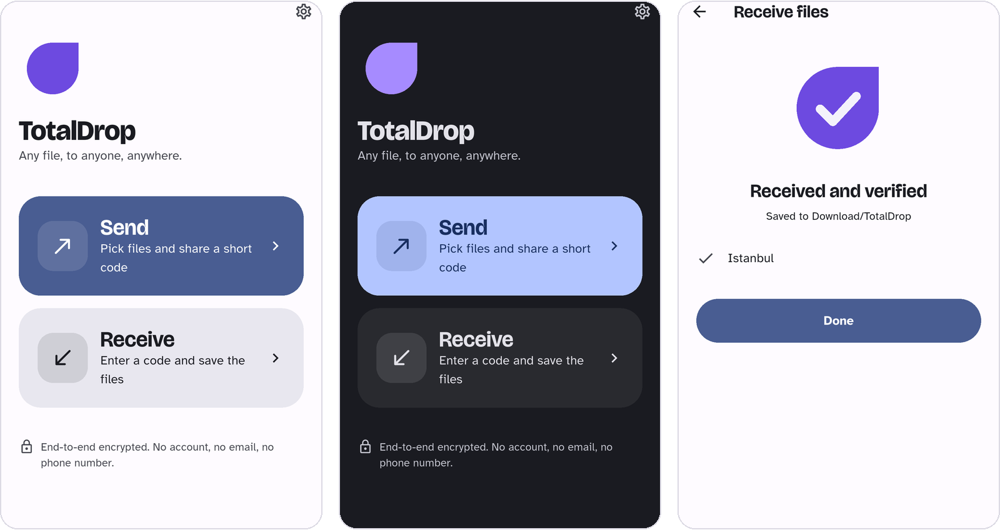
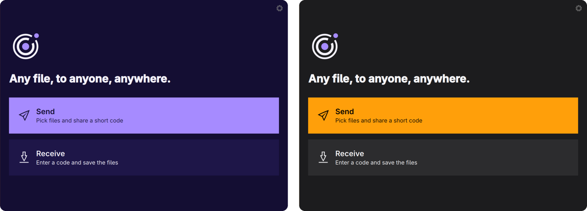

<!-- Translated from README.md e572385d1192. -->
<div align="center">

<picture>
  <source media="(prefers-color-scheme: dark)" srcset="../../docs/assets/lockup-dark.svg">
  
</picture>

### Cualquier archivo, a cualquiera, en cualquier lugar.

Gratis y de código abierto. Cifrado de extremo a extremo. Sin correo electrónico, sin número de teléfono, sin cuenta.

[](https://github.com/totaldrop-app/totaldrop/releases?q=linux&expanded=true)
[](https://totaldrop.app/download/)
[](https://github.com/totaldrop-app/totaldrop/actions/workflows/ci.yml)
[](../../LICENSING.md)
[](https://github.com/sponsors/ozdil)

**[Sitio web](https://totaldrop.app)** · **[Descargar](https://totaldrop.app/download/)** · [Hoja de ruta](https://totaldrop.app/roadmap/) · [Donar](https://totaldrop.app/donate/) · [Versiones](https://github.com/totaldrop-app/totaldrop/releases)

<!-- languages -->
<sub>[العربية](README.ar.md) · [বাংলা](README.bn.md) · [Čeština](README.cs.md) · [Dansk](README.da.md) · [Deutsch](README.de.md) · [Ελληνικά](README.el.md) · [English](../../README.md) · **Español** · [فارسی](README.fa.md) · [Suomi](README.fi.md) · [Français](README.fr.md) · [עברית](README.he.md) · [हिन्दी](README.hi.md) · [Magyar](README.hu.md) · [Bahasa Indonesia](README.id.md) · [Italiano](README.it.md) · [日本語](README.ja.md) · [한국어](README.ko.md) · [Bahasa Melayu](README.ms.md) · [Norsk bokmål](README.nb.md) · [Nederlands](README.nl.md) · [Polski](README.pl.md) · [Português (Brasil)](README.pt-BR.md) · [Português (Portugal)](README.pt-PT.md) · [Română](README.ro.md) · [Русский](README.ru.md) · [Svenska](README.sv.md) · [Kiswahili](README.sw.md) · [ไทย](README.th.md) · [Türkçe](README.tr.md) · [Українська](README.uk.md) · [اردو](README.ur.md) · [Tiếng Việt](README.vi.md) · [简体中文](README.zh-Hans.md) · [繁體中文](README.zh-Hant.md)</sub>
<!-- /languages -->

<br>



</div>

> [!NOTE]
> Esta traducción es un borrador y se está revisando. La referencia es la [versión en inglés](../../README.md).

## Por qué TotalDrop

- **Basta con un código corto.** Elige archivos y obtén un código como `7-harbor-rocket`. Léelo en voz alta o muestra el código QR; la otra persona lo escribe y los archivos llegan.
- **Cifrado de extremo a extremo, y puedes comprobarlo.** Las dos pantallas muestran las mismas cuatro palabras antes de que se mueva nada. Si no coinciden, detente.
- **Sin nada a lo que registrarse.** Sin cuenta, correo electrónico ni número de teléfono. Las cuentas opcionales serán solo un número, al estilo de Mullvad ([diseño](../../docs/hesap.md)).
- **Directo de dispositivo a dispositivo, en cualquier lugar.** El servidor de encuentro solo presenta a los dos dispositivos y no guarda registros; como cualquier servidor, ve sus direcciones IP. Los dispositivos se conectan directamente a través de internet siempre que pueden. Cuando un router o un cortafuegos lo impide, un servidor de retransmisión transporta el tráfico sin poder leerlo.
- **Como en casa en tu sistema.** Las aplicaciones siguen el tema claro u oscuro del sistema, el color de acento, el idioma y el ajuste de movimiento reducido. La aplicación de Linux es Qt 6 nativo en Wayland y además toma en directo las fuentes, las esquinas y los iconos de los temas de KDE Plasma, Hyprland y Omarchy.
- **Gratis, para siempre.** De código abierto y financiado con donaciones. Sin anuncios, sin rastreo, sin plan de pago para lo básico.

<p align="center">
  
  <br><sub>La aplicación de Linux en Omarchy: los colores, las esquinas, las fuentes y los iconos vienen del escritorio.</sub>
</p>

## Descargar

| Plataforma | Descarga | Notas |
| --- | --- | --- |
| **Linux** (x86-64) | [Arch / Omarchy](https://github.com/totaldrop-app/totaldrop/releases/download/linux-v0.2.0-beta.1/totaldrop-0.2.0_beta.1-1-x86_64.pkg.tar.zst) · [Debian / Ubuntu](https://github.com/totaldrop-app/totaldrop/releases/download/linux-v0.2.0-beta.1/totaldrop_0.2.0.beta.1-1_amd64.deb) · [Fedora](https://github.com/totaldrop-app/totaldrop/releases/download/linux-v0.2.0-beta.1/totaldrop-0.2.0.beta.1-1.fc43.x86_64.rpm) | 0.2.0-beta.1, Qt 6.8 o posterior |
| **Linux** (ARM64) | [Debian / Ubuntu](https://github.com/totaldrop-app/totaldrop/releases/download/linux-v0.2.0-beta.1/totaldrop_0.2.0.beta.1-1_arm64.deb) · [Fedora](https://github.com/totaldrop-app/totaldrop/releases/download/linux-v0.2.0-beta.1/totaldrop-0.2.0.beta.1-1.fc43.aarch64.rpm) | 0.2.0-beta.1, Qt 6.8 o posterior |
| **Android** | [Únete a la beta](mailto:hello@totaldrop.app?subject=TotalDrop%20Android%20beta) | 0.2.0-beta.2, Android 15 o posterior, Google Play por invitación |
| **Línea de comandos** | `cargo install --git https://github.com/totaldrop-app/totaldrop totaldrop-cli` | Linux, macOS, Windows |
| **Windows, macOS, iOS** | En camino | La firma de código para estas plataformas es lo primero que pagan las donaciones |

Cada paquete lo compila la CI a partir de un commit etiquetado, nunca en el equipo de un desarrollador. Para comprobar uno antes de instalarlo, compáralo con el `SHA256SUMS` de la versión y verifica dónde se compiló:

```bash
gh attestation verify totaldrop_0.2.0.beta.1-1_amd64.deb --repo totaldrop-app/totaldrop
```

> [!NOTE]
> **Beta.** El código aún no ha pasado una revisión de seguridad independiente, así que no confíes en él para archivos sensibles.

## Cómo funciona

1. El remitente pide un código corto al servidor de encuentro. El código es el único secreto que comparten las dos personas.
2. Los dos dispositivos convierten el código en una clave robusta con **CPace**. Un atacante tiene un solo intento por transferencia y no puede probar códigos sin conexión.
3. Se conectan directamente mediante **QUIC** (TLS 1.3 con claves públicas en bruto fijadas) y ejecutan **Noise XXpsk3 con ML-KEM-768**, que está diseñado para resistir a los futuros ordenadores cuánticos.
4. Los archivos se cifran por bloques (STREAM), de modo que cada fragmento se autentica al llegar.

El protocolo se describe en *TotalDrop Protocol v0*. Las decisiones tomadas al implementarlo están en [docs/protocol-v0.1-notes.md](../../docs/protocol-v0.1-notes.md), y lo que cada servidor puede ver y lo que no, en el [modelo de amenazas](../../docs/tehdit-modeli.md) (en turco) y la [política de privacidad](https://totaldrop.app/privacy).

## En tu idioma

TotalDrop habla 35 idiomas y sigue los formatos numéricos de tu región. El inglés y el turco están revisados; los otros 33 son borradores que están comprobando hablantes nativos, así que las aplicaciones mantienen los textos de seguridad (verificación, código incorrecto, aceptar y rechazar) en inglés hasta que se revise cada idioma. El sitio ya los tiene todos; las aplicaciones los recibirán con sus próximas versiones.

¿Has visto una frase torpe? [Ayuda a traducir](../../docs/ceviri.md) (la guía está en turco).

## Apoya el proyecto

TotalDrop sigue siendo gratis porque la gente contribuye. Las donaciones pagan el servidor de retransmisión, los certificados de firma de código que exigen Windows y macOS, y una auditoría de seguridad independiente antes de la 1.0. Cada coste, partida por partida, y lo recaudado hasta ahora: [totaldrop.app/donate](https://totaldrop.app/donate/).

<a href="https://github.com/sponsors/ozdil"></a>

También puedes ayudar [informando de errores](https://github.com/totaldrop-app/totaldrop/issues/new/choose), traduciendo o haciendo pruebas en tu ordenador.

## Para desarrolladores

### Estructura del repositorio

| Ruta | Qué es | Licencia |
| --- | --- | --- |
| `crates/totaldrop-crypto` | Suite TD0: CPace, derivación de claves, cifrado del buzón y de la sesión, claves de dispositivo, cifrado por bloques STREAM | MIT OR Apache-2.0 |
| `crates/totaldrop-proto` | Códigos de transferencia, límites, seguridad de rutas, todos los mensajes de red (CBOR) | MIT OR Apache-2.0 |
| `crates/totaldrop-core` | Motor del cliente: encuentro, QUIC con claves públicas en bruto, Noise XXpsk3 + ML-KEM-768, transferencia | MIT OR Apache-2.0 |
| `crates/totaldrop-l10n` | Textos de interfaz para los programas en Rust: negociación de idioma, mensajes ICU, plurales, números regionales | MIT OR Apache-2.0 |
| `crates/totaldrop-cli` | El cliente de línea de comandos `totaldrop` | GPL-3.0-or-later |
| `l10n/` | Todas las cadenas de la interfaz, compartidas por Android, Linux y la CLI ([traducción](../../docs/ceviri.md)) | GPL-3.0-or-later |
| `linux/` | Aplicación de escritorio para Linux: Qt 6 y QML sobre `totaldrop-core`, Wayland nativo | GPL-3.0-or-later |
| `packaging/` | Paquetes de Linux, cada formato por separado: Arch (`PKGBUILD`), Debian (`debian/`), RPM (`.spec`) | GPL-3.0-or-later |
| `app/` | Aplicación de Android (Flutter); iOS más adelante | GPL-3.0-or-later |
| `site/` | totaldrop.app, download.totaldrop.app y la página que abren los enlaces QR | GPL-3.0-or-later; fonts SIL OFL 1.1 |
| `fuzz/` | Objetivos de fuzzing para cada analizador | MIT OR Apache-2.0 |
| `server/totaldrop-rendezvous` | Servidor de encuentro en Rust, para autoalojamiento y pruebas | AGPL-3.0-or-later |
| `server/rendezvous-worker` | El mismo servidor en Cloudflare Workers, para `rendezvous.totaldrop.app` | AGPL-3.0-or-later |

Las bibliotecas tienen licencias permisivas para que cualquiera pueda construir sobre el protocolo; las aplicaciones son GPL y los servidores, AGPL. Consulta [LICENSING.md](../../LICENSING.md).

Cada plataforma tiene su propia versión, su propia etiqueta (`linux-v…`, `android-v…`) y su propio flujo de trabajo de CI, así que una puede publicarse sin tocar las demás. Cómo funcionan las ramas y las versiones: [docs/gelistirme.md](../../docs/gelistirme.md) (en turco) y [docs/versioning.md](../../docs/versioning.md). Reglas de diseño: [docs/tasarim.md](../../docs/tasarim.md) y decisiones de arquitectura: [docs/kararlar](../../docs/kararlar/README.md), ambas en turco.

### Compilación

```bash
cargo test
cargo build --release
```

Prueba una transferencia en una sola máquina, con tres terminales:

```bash
# 1. a local rendezvous server
./target/release/totaldrop-rendezvous 127.0.0.1:4000

# 2. the sender prints a code such as 3-harbor-rocket
TOTALDROP_SERVER=ws://127.0.0.1:4000 ./target/release/totaldrop send ./photos

# 3. the receiver
TOTALDROP_SERVER=ws://127.0.0.1:4000 ./target/release/totaldrop receive 3-harbor-rocket
```

Los dos lados muestran las mismas cuatro palabras de verificación. El `ws://` sin cifrar solo se acepta para un servidor en la misma máquina; todo lo demás debe ser `wss://`.

El proyecto siempre usa la versión estable más reciente de Rust (fijada en `rust-toolchain.toml`); rustup la instala en la primera compilación.

**Aplicación de Linux** (necesita Qt 6.8 o posterior: `qt6-base`, `qt6-declarative`, `qt6-wayland`, `qt6-svg`):

```bash
cargo run --release -p totaldrop-linux
packaging/build.sh arch   # or deb, rpm: a package in dist/packages/, built in a container
```

### Contribuciones y seguridad

Lee [CONTRIBUTING.md](../../CONTRIBUTING.md) antes de abrir una pull request, y también nuestro [código de conducta](../../CODE_OF_CONDUCT.md). Las preguntas van en [SUPPORT.md](../../SUPPORT.md). Informa de las vulnerabilidades en privado, como se describe en [SECURITY.md](../../SECURITY.md), nunca en una issue pública.
